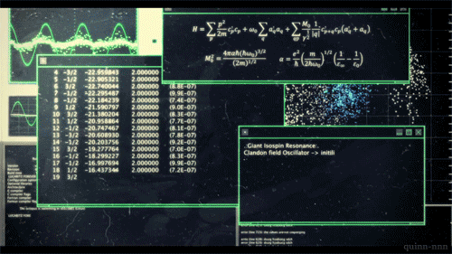

 <!-- GitHub Profile README -->

  

  

  

---

## 👨‍💻 About Me

<table align="center">
  <tr>
    <td width="55%">

- 👋 Hi, I'm **Samnang**!
- 🎓 WMAD Student at PSE Institute.
- 💻 Aspiring Full Stack Developer.
- 🌱 Currently learning React & Spring Boot.
- 🚀 Building real-world web applications.
- 🎮 Interested in Roblox Game Development.
- 🎯 Always improving my coding skills.
- 🤝 Enjoy working with teams and learning new things.

    </td>
    <td width="45%" align="center">
      
    </td>
  </tr>
</table>

---

## 🚀 What I'm Working On

- 🛍️ **Lumiere Beauty** – Developing a cosmetics shop REST API using Spring Boot and PostgreSQL.
- 🔐 **Smart Locker System** – Building a locker management system using Laravel.
- 💡 Exploring new technologies and improving my full-stack development skills.

---

## 🛠️ Tech Stack & Tools

  

---

## 🎥 Project Demo

  

---

## 📊 GitHub Statistics

  
  

---

## 📫 Connect With Me

  

---

  

  ⭐ <b>Learning every day, building step by step.</b>

